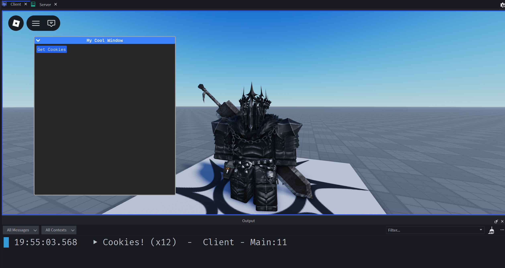

# Your First Window

As said before, everything is Vitre is quick, easy and painless to do.

## Step 1: The Window

Let's start by designing a quick window featuring a clickable button in a `ModuleScript`.

The window component is accessible through `Vitre.Window()`.

```luau
--MyWindow.luau
const Vitre = require(path.to.Vitre)

return function()
    return Vitre.Window {
        Title = "My Cool Window",
        Children = {
            Vitre.Widget.Button {
                Text = "Get Cookies",
                Activated = function()
                    print("Cookies!")
                end
            },
        },
    }
end
```

Every widget such as buttons, text and formatting options are available under the `Vitre.Widget` key.

## Step 2: Rendering

Now that we have a window designed, it's time to render it on the screen!

In order to achive that, we're going to use `Vitre:append()`. The goal of that method is to mount anything to the `ScreenGui` created by Vitre when we ran `Vitre:setup()`.

```luau
--Main.client.luau
const Vitre = require(path.to.Vitre)
const MyWindow = require("@self/MyWindow")

Vitre:setup()
Vitre:append(MyWindow) -- add this
```

## Step 3: Emulate

Press the emulation button in studio and the window should appear.



As you can see our window rendered and the button sinks input!

If you click and hold the blue window header you will aslo be able to drag the window around.
That feature can be disabled by setting the `CanDrag` property to `false` in the window component properties.
